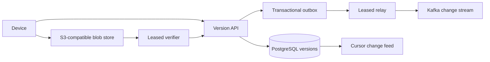

# Distributed File Synchronization Platform

A production-minded Java 17 control plane for synchronizing large file trees across intermittently connected devices. The project tackles the hard backend problems behind file sync: content-addressed storage, optimistic concurrency, durable tombstones, idempotent device operations, immutable version history, conflict visibility, and reliable change publication.

## Current checkpoint

- Tenant-scoped file namespace and immutable version ledger
- SHA-256 content-addressed blob references
- Durable multipart upload sessions with direct-to-S3 presigned part URLs
- Replay-safe session creation and compensating multipart aborts
- Completion checks for expected object size and declared hash metadata
- Streamed server-side SHA-256 verification with leased, retryable workers
- Blob verification status polling and a hard commit gate for unverified bytes
- Compare-and-set updates using client `baseVersion`
- Explicit `409 VERSION_CONFLICT` for stale devices
- Payload-aware idempotent device operations
- Durable delete tombstones
- Transactional file-change outbox
- Horizontally scalable leased Kafka relay using `FOR UPDATE SKIP LOCKED`
- At-least-once publication with stable tenant/file keys and event headers
- Tenant-scoped incremental change feed with monotonic cursors
- Bounded cursor pagination for reconnecting and offline devices
- PostgreSQL constraints and lookup indexes
- Path normalization and traversal protection
- Java 17, Spring Boot, Flyway, PostgreSQL, Kafka, and MinIO
- Unit tests, Docker configuration, CI/CD, API examples, and architecture decisions

## First sync flow

1. A client hashes file bytes and creates an idempotent multipart session.
2. The API returns short-lived presigned part URLs, so file bytes bypass application servers.
3. After all parts are uploaded, completion validates object size and hash metadata and queues cryptographic verification.
4. A leased worker streams the object through SHA-256; the client polls until verification is `VERIFIED`.
5. The client commits metadata with the last server version it observed; unverified content receives `409 BLOB_NOT_VERIFIED`.
6. PostgreSQL locks the path head, rejects stale bases, appends the immutable version, advances the head, and writes an outbox event atomically.
7. Downstream device feeds consume the stable change event; retries are safe through the operation ID.

On reconnect, a device calls `GET /v1/changes?after=<cursor>`. It applies the ordered page locally and advances only to the returned `nextCursor`. Tombstones travel through the same feed, so a device cannot accidentally resurrect content deleted while it was offline.



## Run locally

```bash
docker compose up -d
mvn spring-boot:run
```

See [API examples](api-examples.http) and [architecture decisions](docs/architecture.md).

## Engineering signals for recruiters

This repository demonstrates offline-first concurrency design, immutable data modeling, database-enforced idempotency, transactional event publication, content-addressed storage, and explicit failure semantics. The design is original and based on public distributed-systems patterns; it contains no proprietary GoDaddy or Airtel code.
