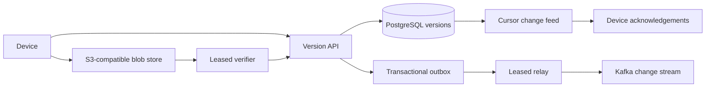

# Distributed File Synchronization Platform

A production-minded Java 17 control plane for synchronizing large file trees across intermittently connected devices. The project tackles the hard backend problems behind file sync: content-addressed storage, optimistic concurrency, durable tombstones, idempotent device operations, immutable version history, conflict visibility, and reliable change publication.

## Current checkpoint

- Tenant-scoped file namespace and immutable version ledger
- SHA-256 content-addressed blob references
- Durable multipart upload sessions with direct-to-S3 presigned part URLs
- Replay-safe session creation and compensating multipart aborts
- Crash-recoverable cleanup of expired multipart uploads with leased workers
- Completion checks for expected object size and declared hash metadata
- Streamed server-side SHA-256 verification with leased, retryable workers
- Blob verification status polling and a hard commit gate for unverified bytes
- Compare-and-set updates using client `baseVersion`
- Explicit `409 VERSION_CONFLICT` for stale devices
- Optional deterministic `KEEP_BOTH` conflict copies for concurrent offline edits
- Atomic compare-and-set file moves and renames that preserve file identity
- Payload-aware idempotent device operations
- Durable delete tombstones
- Transactional file-change outbox
- Horizontally scalable leased Kafka relay using `FOR UPDATE SKIP LOCKED`
- At-least-once publication with stable tenant/file keys and event headers
- Tenant-scoped incremental change feed with monotonic cursors
- Bounded cursor pagination for reconnecting and offline devices
- Durable per-device cursor acknowledgements with monotonic progression
- Active-device compaction watermark for safe retention decisions
- Transactional, concurrency-safe tenant logical storage quotas
- Redis-backed hot manifest reads with strong-consistency bypass
- Quota usage inspection with explicit `413 TENANT_QUOTA_EXCEEDED` failures
- PostgreSQL constraints and lookup indexes
- Path normalization and traversal protection
- Java 17, Spring Boot, Flyway, PostgreSQL, Kafka, and MinIO
- Unit tests, Docker configuration, CI/CD, API examples, and architecture decisions

## First sync flow

1. A client hashes file bytes and creates an idempotent multipart session.
2. The API returns short-lived presigned part URLs, so file bytes bypass application servers.
3. After all parts are uploaded, completion validates object size and hash metadata and queues cryptographic verification.
4. A leased worker streams the object through SHA-256; the client polls until verification is `VERIFIED`.
5. The client commits metadata with the last server version it observed; unverified content receives `409 BLOB_NOT_VERIFIED`.
6. PostgreSQL locks the path head, rejects stale bases, appends the immutable version, advances the head, and writes an outbox event atomically.
7. Downstream device feeds consume the stable change event; retries are safe through the operation ID.

The default conflict policy remains `REJECT`. A client that cannot merge locally may send `KEEP_BOTH`; a stale edit is then committed as a deterministic sibling such as `report (conflict-11111111-a1b2c3d4e5f6).pdf`. The original head is never overwritten, the extension is retained, and retries return the same conflict copy through the existing operation ID.

On reconnect, a device calls `GET /v1/changes?after=<cursor>`. It applies the ordered page locally and advances only to the returned `nextCursor`. Tombstones travel through the same feed, so a device cannot accidentally resurrect content deleted while it was offline.

Moves use the same optimistic-concurrency contract as content updates. A client submits the source version it observed; PostgreSQL serializes both source and destination paths with transaction-scoped advisory locks, rejects stale sources or occupied destinations, appends a `MOVE` version, and moves the namespace head atomically. The file ID, blob reference, and quota usage remain unchanged. Change-feed records expose `changeType=MOVE` and `previousPath`, allowing offline devices to remove the old path and materialize the new one as one logical operation.

After durably applying a page, the device acknowledges its cursor through `PUT /v1/sync/devices/{deviceId}/cursor`. PostgreSQL rejects backwards movement and cursors beyond the tenant feed head. Operators can calculate the minimum acknowledgement across recently active devices before compacting history; inactive devices are deliberately excluded only through an explicit activity window.

Each accepted file mutation updates a locked per-tenant quota ledger in the same PostgreSQL transaction as the immutable version and outbox event. New files and `KEEP_BOTH` copies consume their full logical size, replacements consume only the size delta, and tombstones release the deleted head's bytes. Exact operation replays bypass accounting, so retries never double-charge. Existing tenants are backfilled from live heads; the default 10 GiB allowance is configurable with `DEFAULT_TENANT_QUOTA_BYTES`. Clients can inspect usage through `GET /v1/storage/quota`.

Expired multipart sessions are reclaimed automatically. Worker replicas atomically claim bounded batches with `FOR UPDATE SKIP LOCKED`, transition them to `ABORTING`, and release the database transaction before calling S3. Successful or already-missing remote uploads become `ABORTED`; transient failures return to `READY` with an attempt count and bounded error detail. Expired leases allow another replica to recover work after a crash, while Prometheus exposes aborted and retry outcomes.

`GET /v1/files/metadata/{path}` serves hot manifests from Redis and falls back to PostgreSQL on a miss or cache outage. Mutations evict affected paths only after the database transaction commits, preventing uncommitted state from reaching readers. Cache failures are fail-open and entries expire after 30 seconds, so Redis is an acceleration layer rather than a correctness dependency. Callers that require read-after-write certainty can send `?strong=true` to bypass Redis and refresh the cached manifest from PostgreSQL.



## Run locally

```bash
docker compose up -d
mvn spring-boot:run
```

See [API examples](api-examples.http) and [architecture decisions](docs/architecture.md).

## Engineering signals for recruiters

This repository demonstrates offline-first concurrency design, immutable data modeling, database-enforced idempotency, transactional event publication, concurrency-safe quota accounting, content-addressed storage, and explicit failure semantics. The design is original and based on public distributed-systems patterns; it contains no proprietary GoDaddy or Airtel code.
